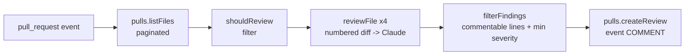

# ai-pr-reviewer

GitHub Action that reviews pull requests with Claude and leaves inline comments.

[](https://github.com/Muhaman/ai-pr-reviewer/actions/workflows/ci.yml)

## What it does

On every pull request the action lists the changed files, skips the noise (lockfiles, `dist/`, minified files, removed files, oversized patches, anything matching your `exclude` globs), and asks Claude to review each remaining file's diff. Findings come back as structured output, are checked against the lines GitHub will actually accept comments on, and are posted as a single review with inline comments. If nothing is found, you get a summary-only review. A file that fails to review (API error, refusal, truncated output) is reported as skipped in the summary and never fails the others.

## Architecture



| File | Role |
|---|---|
| `src/diff.ts` | Parses unified-diff hunks; commentable new-file lines; line-numbered diff for the prompt |
| `src/filter.ts` | `shouldReview` file filter (picomatch globs) |
| `src/review.ts` | Prompt, `reviewFile`, `filterFindings` |
| `src/llm.ts` | Anthropic client, structured output schema, refusal and truncation errors |
| `src/github.ts` | Thin `PullsClient` over Octokit and review comment formatting |
| `src/main.ts` | `run`: orchestration with concurrency 4 and per-file error isolation |
| `src/config.ts` | Input parsing and validation |
| `src/index.ts` | Action entry point (bundled to `dist/index.js`) |

## Quickstart

```yaml
# .github/workflows/ai-review.yml
name: AI review
on: pull_request

permissions:
  contents: read
  pull-requests: write

jobs:
  review:
    runs-on: ubuntu-latest
    steps:
      - uses: Muhaman/ai-pr-reviewer@main
        with:
          anthropic_api_key: ${{ secrets.ANTHROPIC_API_KEY }}
```

Add `ANTHROPIC_API_KEY` as a repository secret. The action does not need a checkout; it reads diffs through the API.

## Usage

| Input | Default | Description |
|---|---|---|
| `anthropic_api_key` | required | Anthropic API key |
| `github_token` | `${{ github.token }}` | Token for reading the PR and posting the review |
| `model` | `claude-opus-5-5` | Claude model |
| `max_files` | `20` | Max files reviewed per PR; extra files are noted in the summary |
| `min_severity` | `minor` | One of `info`, `minor`, `major`, `critical` |
| `exclude` | empty | Newline-separated globs to skip |

```yaml
- uses: Muhaman/ai-pr-reviewer@main
  with:
    anthropic_api_key: ${{ secrets.ANTHROPIC_API_KEY }}
    min_severity: major
    exclude: |
      docs/**
      **/*.snap
```

PRs from forks do not receive repository secrets, so the review is only useful for same-repo branches unless you opt into `pull_request_target` with the usual security caveats.

## Design decisions & trade-offs

- **Line-numbered diffs in the prompt.** Models are poor at counting diff lines. Every added or context line is prefixed with its new-file line number, and findings are dropped unless the line is in the set GitHub will accept for a `RIGHT`-side comment, so one bad line number cannot make `createReview` return 422 for the whole review.
- **One request per file.** Keeps context small and failures isolated, at the cost of cross-file reasoning.
- **Structured output via Zod.** The response is validated against a schema; `stop_reason` is checked for `refusal` and `max_tokens` before the parsed output is read, and both surface as per-file errors in the summary.
- **Refusal fallback.** Requests opt into the server-side fallback (`fallbacks: "default"`) so a policy refusal can be retried by the API on a substitute model.
- **Bundled `dist/`.** A JavaScript action must ship its code. `build-dist.yml` bundles with esbuild and commits `dist/` as `github-actions[bot]`; its paths filter (`src/**`, `package.json`) excludes `dist/`, so the bot commit does not retrigger it.
- **Single review, event `COMMENT`.** The action never approves or requests changes.

## Testing

```bash
npm install
npm run lint && npm run typecheck && npm test
```

Unit tests cover hunk parsing (including multi-hunk patches), the file filter, finding filtering, and `run` with a mocked GitHub client and a fake LLM (comment count, per-file failure isolation, summary-only reviews, `max_files`). The LLM adapter itself is exercised only in real workflow runs. The repo's own `self-review.yml` runs the action on its PRs when the `ANTHROPIC_API_KEY` secret exists and is a no-op otherwise.

## Limitations & next steps

- Per-file diffs only: no repository context, no cross-file analysis.
- Files with patches over 20,000 characters are skipped rather than chunked.
- Re-running on a PR posts a new review rather than updating the previous one.
- GitHub omits `patch` for binary and very large files; those are skipped.

## License

MIT
